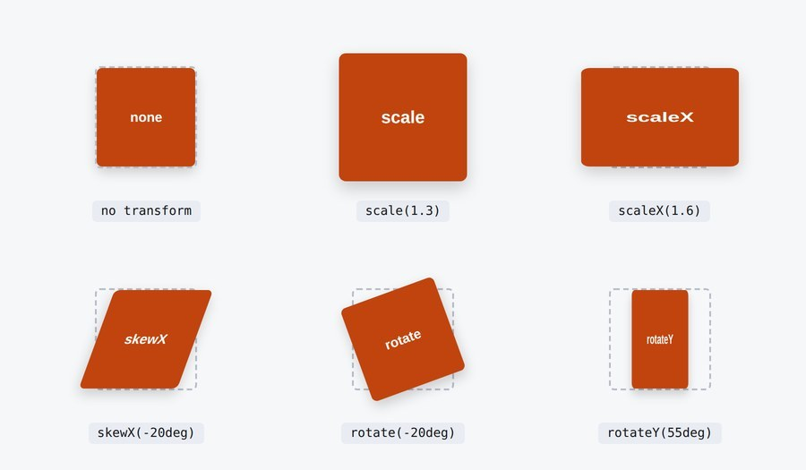

# Week 07 — Transforms & Transitions

*A wall of polaroids that scale, skew, rotate and fade · ~55 min of live coding*

> **Following along at home?** Work through the steps in order. Copy
> `StarterFiles/` into your own repo to start — it has the HTML and all the
> photographs; the stylesheet is empty and we fill it together.

You have used `transform` and `transition` once already, on the portfolio
gallery in Week 05. Today we take them apart properly: five transform
functions, what each one does to a box, and the three parts of a transition.

The page we build is a pinned wall of polaroids — a nav bar across the top, and
a grid of photographs, each one doing something different.

Stuck? Read the error first, then [TROUBLESHOOTING.md](../../../TROUBLESHOOTING.md).

---

## The five functions, at a glance



The **dashed outline is where the box started**, and it is the most important
thing in that picture: `transform` moves what you *see* without moving the
space the element occupies. Nothing around it shifts. That is what makes
transforms safe to animate — and it is why they behave completely differently
from changing `width` or `margin`.

| Function | What it does |
|---|---|
| `scale(n)` | bigger or smaller. One number scales both directions |
| `scale(x, y)` / `scaleX()` / `scaleY()` | stretch one axis at a time |
| `skew(xdeg, ydeg)` / `skewX()` / `skewY()` | lean it over, like italics for boxes |
| `rotate(deg)` | spin it. Negative is counter-clockwise |
| `rotateX()` / `rotateY()` / `rotateZ()` | spin it in 3D, around an axis |
| `translate(x, y)` | nudge it, without disturbing anything |

---

## Steps

1. [Files and photographs](#step-1)
2. [Page setup: reset, background, fonts](#step-2)
3. [The fixed nav bar](#step-3)
4. [The polaroid grid](#step-4)
5. [scale — one number or two](#step-5)
6. [skew — italics for boxes](#step-6)
7. [rotate, in two dimensions](#step-7)
8. [rotate, in three](#step-8)
9. [transition: the three parts](#step-9)
10. [Transforms on hover](#step-10)
11. [filter, while we are here](#step-11)
12. [In-class exercise](#step-12)

---

<a id="step-1"></a>

## Step 1 — Files and photographs

Copy the whole of `StarterFiles/` into your own homework repo:

```
transforms/
├── index.html          ← the markup, already written
├── css/
│   └── style.css       ← empty. This is the part we write
└── img/
    ├── bg.jpg
    ├── cork-board.webp
    ├── bw/             ← six black and white photos
    └── color/          ← the same six in colour
```

Open `index.html` and read it before we style anything. A `<header>` with an
`<h1>` and a `<nav>`, then a `.container` holding twelve `.polaroid` divs. Each
polaroid is a `<p>` caption and an ``, and each one carries a second class
— `scale_up`, `skew_x`, `rot_y` and so on. **Those second classes are the
lesson**: each is one transform we are about to write.

In the browser it is currently a very long column of enormous photographs.

---

<a id="step-2"></a>

## Step 2 — Page setup: reset, background, fonts

Revision, so take it in one go.

**`css/style.css`**

```css
/* always load custom fonts and other dependencies
(like other stylesheets or CSS vars) first */
@import url('https://fonts.googleapis.com/css2?family=Kaushan+Script&display=swap');

/* Universal selector to reset some defaults */
* {
  margin: 0;
  padding: 0;
}

/* this is how we get a full size H&W image background */
html {
  background: url('../img/bg.jpg') no-repeat center center fixed;
  background-size: cover;
}

/* apply the default font styles to the body so
all other elements within can inherit them */
body {
  font-family: 'Kaushan Script', cursive;
}
```

Three things worth a second look:

- **`@import` goes at the very top.** A stylesheet's imports must come before
  any rules, or the browser ignores them.
- **`background: url(...) no-repeat center center fixed`** is shorthand for
  four separate properties at once. `fixed` is what makes the background stay
  put while the page scrolls.
- **The path is `../img/bg.jpg`**, not `img/bg.jpg`. Paths in a stylesheet are
  relative to *the stylesheet*, which lives in `css/`, so you have to climb out
  first. This catches everybody once.

---

<a id="step-3"></a>

## Step 3 — The fixed nav bar

Also revision: `position: fixed`, flexbox, and a background image on the
header.

```css
header {
  width: 80%;
  padding: 0 10%;
  height: 50px;
  overflow: hidden;
  position: fixed;
  top: 0;
  left: 0;
  z-index: 100;
  display: flex;
  flex-direction: row;
  justify-content: space-between;
  align-items: center;
  background: url('../img/cork-board.webp');
}

header h1 {
  color: #333;
}

nav ul {
  display: flex;
  list-style-type: none;
  text-align: center;
  background-color: rgba(40, 40, 40, 0.4);
}

nav li {
  font-size: 18px;
  height: 50px;
  line-height: 50px;
  width: 120px;
}

nav a {
  text-decoration: none;
  color: #fff;
  display: block;
  /* always define the transition property on the starting state */
  transition: all 1s;
}

nav a:hover {
  background-color: rgba(40, 40, 40, 0.7);
  color: red;
}

nav a.active {
  background-color: black;
  color: yellow;
}
```

`width: 80%` plus `padding: 0 10%` adds up to 100% — the padding is *inside* the
width because of the box model, which is exactly the arithmetic from Week 04.
And `line-height` equal to the height is the oldest trick there is for
vertically centring a single line of text.

---

<a id="step-4"></a>

## Step 4 — The polaroid grid

```css
.container {
  width: 900px;
  margin: 0 auto;
  margin-top: 100px;
  /* the polaroids are inline-block, so zero the font size on the parent
     to kill the whitespace gaps between them */
  font-size: 0;
}

.polaroid {
  width: 260px;
  margin: 20px;
  display: inline-block;
  /* the positioning parent for the caption */
  position: relative;
}

.polaroid img {
  width: 100%;
  height: auto;
  border: 10px solid #ccc;
  border-bottom-width: 45px;
}

.polaroid p {
  position: absolute;
  bottom: 5px;
  width: 280px;
  text-align: center;
  font-size: 1.5rem;
  color: #333;
}
```

Everything here is from Week 04 and Week 05: `inline-block` with the
`font-size: 0` fix for the whitespace gap, a thick bottom border faking the
polaroid's white strip, and `position: relative` on the parent so the caption
can be `absolute` inside it.

Now you have a wall of twelve identical polaroids. Everything after this changes
how they *look* without changing where they *sit*.

---

<a id="step-5"></a>

## Step 5 — scale: one number or two

```css
/* one number = uniform scale */
.scale_up {
  transform: scale(1.2);
  z-index: 10;
}

/* 2 numbers = x, y */
.scale_x {
  transform: scale(2, 1);
}

/* or name the axis you want */
.scale_y {
  transform: scaleY(2);
}
```

`scale(1.2)` is 120% in both directions. `scale(2, 1)` is double width, normal
height. `scaleY(2)` is the same idea with the axis in the function name — use
whichever reads more clearly.

**Why `z-index: 10` on the first one?** Scaling it up makes it overlap its
neighbours, and without a stacking order it goes *behind* them. Remember that
`z-index` only works on positioned elements — `.polaroid` is `relative`, so it
works here.

Notice the gaps did not change. The grid still thinks every polaroid is 260px
wide.

---

<a id="step-6"></a>

## Step 6 — skew: italics for boxes

```css
.skew_x {
  transform: skewX(-20deg);
}

.skew_y {
  transform: skewY(-20deg);
}

.skew_both {
  transform: skew(10deg, 30deg);
}
```

Skew leans the box over, pushing the top and bottom edges in opposite
directions. `skewX` leans it sideways; `skewY` tips it up at one end. Doing both
at once gets strange fast, which is the point of the third one.

Angles are in **`deg`**, and negative goes the other way.

---

<a id="step-7"></a>

## Step 7 — rotate, in two dimensions

```css
.rotate_left {
  transform: rotate(-20deg);
}
```

Plain `rotate()` spins the element on the flat plane of the screen, around its
centre. Negative is counter-clockwise, positive is clockwise.

This is the one you will actually use. A photograph pinned at a slight angle,
a badge tilted in a corner, an icon flipped 180 degrees — all `rotate()`.

---

<a id="step-8"></a>

## Step 8 — rotate, in three

```css
.rot_x {
  transform: rotateX(120deg);
}

.rot_y {
  transform: rotateY(120deg);
}

.rot_z {
  transform: rotateZ(120deg);
}
```

Three axes, and the easiest way to keep them straight:

- **`rotateX`** tips it towards you and away, like a door with hinges along the
  top — the way a laptop screen opens
- **`rotateY`** spins it like a revolving door, hinges down the side
- **`rotateZ`** is identical to plain `rotate()` — the Z axis points out of the
  screen at your face

`rotateX` and `rotateY` look squashed rather than three-dimensional here, and
that is correct: real depth needs a **`perspective`** on the *parent*, which is
exactly what makes the flip card work. Try adding `perspective: 800px` to
`.container` and reload. Same transforms, suddenly convincing.

---

<a id="step-9"></a>

## Step 9 — transition: the three parts

A transform happens instantly unless you ask for time.

```css
transition: all 5s ease-in-out;
/*          ^    ^   ^
            |    |   the speed curve
            |    how long
            what to animate                */
```

- **what** — a property name like `transform` or `background-color`, or `all`
  for everything. `all` is fine while learning and slightly wasteful in
  production
- **how long** — `5s`, `400ms`. Five seconds is absurd for a real interface and
  perfect for a classroom, because you can watch it happen
- **the speed curve** — `ease`, `linear`, `ease-in`, `ease-out`,
  `ease-in-out`. `ease-in` starts slow; `ease-out` ends slow; `linear` is
  robotic and usually wrong

And the rule you keep being told, because it keeps catching people:

> **Put the transition on the resting state, not on `:hover`.**

On the resting rule it animates *both* ways — in and out. On the `:hover` rule
it fades in and snaps back.

---

<a id="step-10"></a>

## Step 10 — Transforms on hover

Now the two together. A resting transform, a different one on hover, and a
transition on the resting state to carry it between them.

```css
.rotate_left {
  transform: rotate(-20deg);
  transition: all 5s ease-in-out;
}

.rotate_left:hover {
  transform: rotate(20deg);
  cursor: pointer;
}

.skew_hover {
  transform: skewX(30deg);
  transition: all 1s ease;
}

.skew_hover:hover {
  transform: skewX(-30deg);
}
```

From −20° to +20° over five seconds. Hover it, then pull your mouse away
halfway through — it turns around and goes back from wherever it had got to.
That is the transition working in both directions, and it is the thing you lose
if you put it in the wrong rule.

`cursor: pointer` is a small one that matters: it tells people the thing is
interactive.

---

<a id="step-11"></a>

## Step 11 — filter, while we are here

Not a transform, but it transitions the same way and you will want it:

```css
.color_swap {
  filter: grayscale(100%) blur(5px);
  transition: all 5s ease-out;
}

.color_swap:hover {
  filter: grayscale(0%);
}
```

`filter` is image editing in CSS: `grayscale`, `blur`, `brightness`,
`contrast`, `saturate`, `sepia`, `invert`, `drop-shadow`. Stack several in one
declaration, separated by spaces.

Greyscale photos that bloom into colour on hover is a real pattern on real
portfolio sites, and it is two rules.

---

<a id="step-12"></a>

## Step 12 — In-class exercise

**Make every transform on the page happen only on hover.**

Right now most of the polaroids sit permanently squashed or skewed. Rework them
so each one starts normal and transforms when you point at it.

For each polaroid:

- move the transform from the base rule into a `:hover` rule
- give the base rule a resting transform — `transform: scale(1) rotate(0deg)`
  — because you cannot transition from nothing
- add a transition to the base rule

Then **make them all different**. Explore:

- **duration** — try `200ms` against `2s` and decide which you would ship
- **speed curves** — `ease-in`, `ease-out`, `linear`, `ease-in-out`
- **delay** — a fourth value: `transition: all 300ms ease 150ms` waits 150ms
  before starting

[W3Schools: CSS3 transitions](http://www.w3schools.com/css/css3_transitions.asp)
has the full property list if you want to go further.

**Bonus:** combine two functions in one transform —
`transform: scale(1.2) rotate(5deg)` — and remember the order matters.

---

## Worth keeping

| Pattern | The line |
|---|---|
| Grow on hover | `transform: scale(1.1)` |
| Pinned-photo tilt | `transform: rotate(-3deg)` |
| Flip a card | `rotateY(180deg)` + `perspective` on the parent |
| Fade colour in | `filter: grayscale(100%)` → `grayscale(0%)` |
| Make any of it smooth | `transition` on the **resting** state |

All of this is fair game for your midterm, and all of it is cheap — transforms
and opacity are the two things browsers animate most efficiently, because
neither one disturbs the layout around it.
